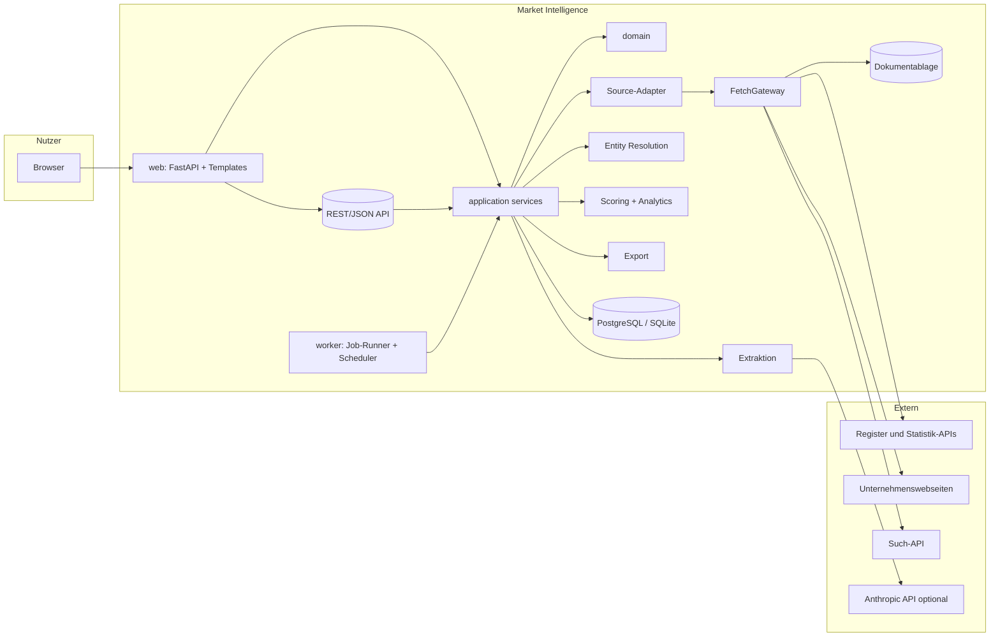
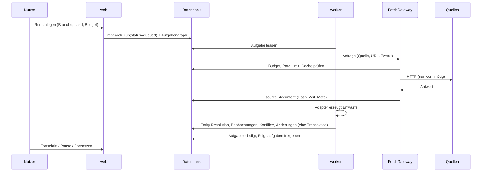

# Architektur – Yellotools Market Intelligence

Stand: 2026-10-18 · Phase 1 (Planung) · Status: **Entwurf zur Freigabe**

Dieses Dokument enthält (1) die Bestandsaufnahme der vorhandenen Repositories, (2) die
begründete Grundsatzentscheidung, (3) die Architekturentscheidungen (ADRs), (4) Komponenten,
Schnittstellen und Datenflüsse sowie (5) Risiken. Fachliche Anforderungen stehen in
`PRODUCT_SPECIFICATION.md`, das Datenmodell in `DATA_MODEL.md`, Quellen in
`RESEARCH_SOURCES.md`, Meilensteine in `IMPLEMENTATION_ROADMAP.md`, Sicherheit und Datenschutz in
`SECURITY_AND_PRIVACY.md`.

---

## 1. Bestandsaufnahme

Alle Angaben wurden am 2026-10-18 durch Lesen der Repositories und Ausführen der Tests ermittelt.
Nichts davon wurde verändert.

### 1.1 `Ilyano165/MARKT-ANALYSE` (dieses Repository)

| Prüfpunkt | Befund |
|---|---|
| Inhalt | **leer** – kein Commit, keine Datei, Branch `claude/confident-faraday-0tsww5` ohne Historie |
| Architektur, Code, Tests, Build, Installer | nicht vorhanden |

Folge: Es gibt hier nichts, was beeinträchtigt oder überschrieben werden könnte. Die
Market-Intelligence-Anwendung beginnt in diesem Repository auf der grünen Wiese.

### 1.2 `Ilyano165/AUFTRAGSIMPORT2.0` (bestehender Yellotools-Auftragsimport, aktueller Stand)

| Prüfpunkt | Befund |
|---|---|
| Branch `main` | nur `.github/workflows/azure-functions-app-dotnet.yml` (unveränderte GitHub-Vorlage für .NET 6 / Azure Functions mit Platzhalter `your-app-name`, passt nicht zum Python-Projekt) und das Archiv `icware-auftragsimport-2.0-windows-build-vorbereitet.zip` |
| Branch `claude/focused-tesla-q81pbc` (Commit `73249a3`, 2026-10-07) | vollständiges Projekt `icware-auftragsimport` 2.0, Herausgeber IC-Ware |
| Sprache, Laufzeit | Python ≥ 3.12.6 (`.python-version` 3.14.4), `src`-Layout, Paket `icware_auftragsimport` |
| Umfang | ca. 23 200 Zeilen Code in `src/`, ca. 9 500 Zeilen Tests in `tests/` |
| Abhängigkeiten | Kern nur `defusedxml==0.7.1`; optional `PySide6==6.11.2` (GUI), `keyring==25.7.0` (Windows-Anmeldespeicher); Dev: `pytest`, `pytest-cov`, `mypy` (strict), `ruff`, `pip-audit`; Build: `pyinstaller`, WiX 5 |
| Oberfläche | PySide6-Desktopanwendung (`gui/`), lange Vorgänge in eigenem `QThread` (`gui/fetch.py`), High-DPI-Screenshots in `docs/gui/` |
| Datenhaltung | lokale SQLite-Datei (WAL, `synchronous=FULL`, Fremdschlüssel), Migrationen über `PRAGMA user_version` mit Sicherung vor Migration (`infrastructure/db.py`), Journal-Tabelle, Idempotenzschlüssel, Revisionstabelle für Aufträge |
| Herkunftsmodell | `domain/provenance.py`: `Field` mit Zustand (erkannt/prüfen/unbekannt/manuell) und `Evidence` (Regel, Begründung, Sicherheit, Fundstelle) – Grundsatz „Nichts wird geraten“ |
| Konfiguration | validierte `settings.json` ohne Geheimnisse (`config/schema.py`), IT-Richtlinie `policy.json` in `%PROGRAMDATA%` (`config/policy.py`), Ablageorte nach Windows-Konvention (`infrastructure/paths.py`) |
| Sicherheit | Passwörter nur im Windows-Anmeldespeicher (`security/credentials.py`), Protokollbereinigung (`security/redaction.py`), sicheres XML (`security/safe_xml.py`), Grenzwerte, Absturzberichte ohne Variableninhalte, Bedrohungsmodell und Sicherheitsbericht in `docs/security/` |
| Fehlerbehandlung | `domain/errors.py`: jede erwartete Fehlermeldung besteht aus *was*, *warum*, *was unverändert blieb*, *was zu tun ist* |
| Tests | `tests/unit`, `integration`, `regression`, `security`, `gui`, `export`; Ausführung am 2026-10-18 unter Linux/Python 3.13 ohne GUI-Tests: **734 bestanden, 21 übersprungen, 1 xfail**. Übersprungen: echte IMAP-Anbieter ohne Zugangsdaten. Nicht ausgeführt: `tests/gui`, `tests/unit/test_packaging_contracts.py`, `tests/unit/test_release_audit.py` (benötigen Qt-Grafikbibliotheken, im Container nicht vorhanden) |
| Build, Installer | `tools/release/build.py`, PyInstaller-Spec, WiX-MSI (`packaging/wix/AuftragsImport.wxs`), Workflow `windows-release.yml` (Actions auf Commit-SHAs gepinnt); laut `CHANGELOG.md` **lief der Windows-Build noch nie unter Windows, Code-Signatur nicht konfiguriert** |
| Updates | `services/updates.py`: nur Manifest-Prüfung und Versionsvergleich, bewusst ohne Download; Zielbild TUF/`tufup`; heute Verteilung über die IT (MSI) |
| Produktversprechen | README: „Es werden keine Daten an Dritte übertragen und keine KI-Dienste verwendet.“ |
| Hinweis | `integration/lexware/reference/248090.xml` enthält echte Firmendaten von Yellotools |

### 1.3 `Ilyano165/YT-Import-auftrag` (Vorgänger, Version 1.1.0)

Ältere, kleinere Fassung (ca. 3 800 Zeilen, Paket `yt_orders`, PySide6, `pypdf`, `openpyxl`,
`keyring`, IMAP, openTRANS-Export). Funktional durch 2.0 abgelöst. Enthält nur eine
Beispiel-Artikelliste (`article_catalog.example.json`, drei Artikel wie `YT23WSLOAN01`
„WrapStick Sloan“). Für Market Intelligence nur als Hinweis auf das Artikelnummernschema relevant.

### 1.4 Wiederverwendbare Bausteine aus dem Auftragsimport 2.0

| Baustein im Auftragsimport | Wiederverwendung in Market Intelligence | Art |
|---|---|---|
| `domain/provenance.py` (Field, Evidence, Confidence) | Vorbild für `Evidence` und Beobachtungsstatus; erweitert um Quelle, Zeitraum, Herkunftsklasse | Konzept übernehmen, neu implementieren |
| `domain/errors.py` (UserMessage mit vier Teilen) | identisches Fehlermeldungsschema in UI und API | kopieren und anpassen |
| `infrastructure/db.py` (Migration mit Sicherung, `BEGIN IMMEDIATE`) | Prinzipien übernehmen; technisch Alembic (siehe ADR-04) | Konzept |
| Journal-Tabelle, Idempotenzschlüssel | `audit_log`, Idempotenz bei Recherche-Aufgaben | Konzept |
| `security/redaction.py` | Protokollbereinigung | kopieren, Regeln um API-Schlüssel-Formate ergänzen |
| `security/credentials.py` (keyring-Store, Env-Fallback, Memory-Store für Tests) | API-Schlüssel der Datenquellen | kopieren und anpassen |
| `infrastructure/atomic.py`, `lock.py` | Exportdateien, Einzelinstanz im lokalen Modus | kopieren |
| `infrastructure/logging_setup.py`, Rotation, Absturzberichte | Protokollierung | kopieren und anpassen |
| `config/policy.py` (IT-Richtlinie, verbotene Geheimnis-Schlüssel) | Richtlinie für Kostenlimits und erlaubte Quellen | Konzept |
| Qualitätswerkzeuge (`ruff`-Regelsatz, `mypy --strict`, gepinnte Actions, Sperrdateien mit Prüfsummen, `pip-audit`) | identisch übernehmen | kopieren |
| Katalog-Import (`catalog/xlsx.py`, `mapping.py`, `validation.py`) | Import des Yellotools-Artikelstamms als Grundlage für `ProductCategory` | Konzept, ggf. Kopie |

Code wird **kopiert, nicht importiert** (keine Laufzeitabhängigkeit zwischen den Produkten).
Beide Repositories gehören demselben Inhaber; vor dem Kopieren wird die Lizenzzeile geprüft
(„Proprietär“, IC-Ware). Erst wenn beide Produkte stabil sind, kann ein gemeinsames Paket
(`icware-core`) ausgelagert werden – nicht in Phase 1–3.

---

## 2. Grundsatzentscheidung: eigenständige Anwendung

**Entscheidung:** Market Intelligence wird als **eigenständige Anwendung in diesem Repository**
gebaut – ohne gemeinsame Datenbank, ohne gemeinsamen Prozess und ohne Codeabhängigkeit zum
Auftragsimport.

**Begründung:**

1. **Produktversprechen und Bedrohungsmodell.** Der Auftragsimport sichert zu, keine Daten an
   Dritte zu übertragen und keine KI-Dienste zu nutzen; sein Bedrohungsmodell setzt das voraus.
   Market Intelligence lebt von ausgehenden Internetanfragen und nutzt optional ein
   Sprachmodell. Ein Modul im selben Produkt würde dieses Versprechen brechen und die
   Sicherheitsfreigabe des Auftragsimports entwerten.
2. **Betriebsmodell.** Der Auftragsimport ist eine Einzelplatz-Desktopanwendung (Daten je
   Windows-Benutzer in `%LOCALAPPDATA%`, Instanzsperre). Market Intelligence braucht
   stundenlange Hintergrundrecherchen, die unabhängig von einem geöffneten Fenster laufen,
   nächtliche Aktualisierungen von Watchlists und gemeinsame Daten für ein Vertriebsteam.
3. **Release-Risiko.** Der Windows-Build des Auftragsimports ist noch nicht auf echtem Windows
   gelaufen, die Signatur fehlt. Zusätzliche Abhängigkeiten (HTTP-Client, PDF-Verarbeitung,
   LLM-SDK, Webserver) würden Installer, Audit-Umfang und Angriffsfläche vergrößern und die
   ohnehin offene Freigabe verzögern.
4. **Keine fachliche Überschneidung.** Gemeinsam ist nur der Artikelstamm. Er wird als Datei
   (CSV/XLSX-Export aus Lexware bzw. dem Katalog) importiert – eine Einbahnstraße ohne
   Kopplung.
5. **Ausfallsicherheit.** Ein Fehler oder eine Überlast in der Recherche kann die
   Auftragserfassung so nachweislich nicht beeinträchtigen.

Verworfene Alternative „Modul im Auftragsimport“: kurzfristig weniger Infrastruktur, aber
Gründe 1–3 sind Ausschlusskriterien.

---

## 3. Architekturentscheidungen (ADRs)

Jede ADR hat Status *vorgeschlagen*, bis die Phase-1-Freigabe erfolgt.

### ADR-01 Sprache und Werkzeuge: Python 3.12+

Gleiche Sprache und Qualitätsregeln wie der Auftragsimport (`ruff`, `mypy --strict`, `pytest`,
Sperrdateien mit Prüfsummen, `pip-audit`). Python hat die besten Bibliotheken für HTTP,
PDF/HTML-Extraktion, Datenanalyse und das offizielle Anthropic-SDK. Das Team kennt die
Konventionen bereits.

### ADR-02 Modularer Monolith mit Ports und Adaptern, zwei Prozesse

Eine Codebasis, streng geschichtet:

```
domain  ←  application  ←  adapters (persistence, http, sources, extraction, search)
                         ←  web (FastAPI)   ←  worker (Job-Runner)   ←  cli
```

- `domain` kennt weder Datenbank noch HTTP noch UI.
- `application` orchestriert Anwendungsfälle über Protokolle (`ports`).
- Die Schichtregeln werden mit `import-linter`-Verträgen im CI erzwungen.

Laufzeit: zwei Prozesse aus derselben Codebasis – **`web`** (Oberfläche und API) und
**`worker`** (Recherche, Extraktion, Scoring, Zeitpläne). Die Oberfläche blockiert dadurch nie;
ein abstürzender Worker beeinträchtigt die Oberfläche nicht.

Microservices wurden verworfen: für ein kleines Team und eine Nutzerzahl im ein- bis
zweistelligen Bereich ist der Betriebsaufwand nicht gerechtfertigt.

### ADR-03 Oberfläche: Web-UI (FastAPI + serverseitige Templates + HTMX)

- FastAPI, Jinja2-Templates mit Autoescaping, HTMX für Teilaktualisierungen, Diagramme mit einer
  lokal ausgelieferten Chart-Bibliothek (Apache ECharts, Version gepinnt, kein CDN).
- Kein Single-Page-Framework und keine Node-Buildkette: weniger Abhängigkeiten, Python-only-Team.
- Gründe gegen PySide6 wie im Auftragsimport: Mehrbenutzerbetrieb, Hintergrundjobs ohne offenes
  Fenster, einfacher Zugriff für Außendienst und Geschäftsführung über den Browser.
- Lokaler Einzelplatzmodus: Server bindet ausschließlich an `127.0.0.1`, Zugang mit
  Sitzungsschlüssel, Schutz gegen DNS-Rebinding (Host-Header-Prüfung) und CSRF.

### ADR-04 Datenbank: SQLAlchemy 2.0 Core + Alembic; PostgreSQL produktiv, SQLite für Einzelplatz

- **PostgreSQL ≥ 16** ist das Zielsystem für Teambetrieb (Nebenläufigkeit, `SKIP LOCKED` für die
  Jobwarteschlange, JSONB, Volltextsuche, `pg_trgm` für unscharfe Namenssuche).
- **SQLite (WAL)** für Einzelplatz-Pilot und Entwicklung, mit genau einem Worker.
- SQLAlchemy **Core** (kein ORM-Zustand), explizite Repository-Funktionen; Migrationen mit
  Alembic, Sicherung vor jeder Migration (Prinzip aus dem Auftragsimport).
- Beträge als `NUMERIC(24,6)` (PostgreSQL) bzw. als Dezimal-Text über einen `TypeDecorator`
  (SQLite) – niemals `float`.
- CI testet jede Migration und jede Repository-Funktion gegen **beide** Datenbanken.

### ADR-05 Persistente Jobwarteschlange in der Datenbank (kein Redis/Celery)

- `research_run` (Auftrag) → `research_task` (Einzelschritte, Graph mit Abhängigkeiten).
- Worker holt Aufgaben mit Lease (`leased_until`, Heartbeat). Abgelaufene Leases werden nach
  Absturz neu vergeben; jede Aufgabe ist idempotent (Idempotenzschlüssel aus Typ + Parametern).
- Pausieren, Fortsetzen, Abbrechen sind Zustandswechsel in der Datenbank; laufende Aufgaben
  prüfen vor jedem externen Aufruf den Zustand ihres Runs (kooperatives Anhalten).
- Zeitpläne (Watchlist-Aktualisierung) als Tabelle `schedule`, ausgewertet vom Worker.
- Begründung: eine Infrastrukturkomponente weniger, Zustand vollständig nachvollziehbar und
  transaktional mit den Ergebnissen gespeichert.

### ADR-06 Ein zentrales Fetch-Gateway für jeden externen Zugriff

Kein Adapter öffnet selbst Netzwerkverbindungen. Alle Anfragen laufen durch das `FetchGateway`
(`httpx`), das nacheinander prüft und erzwingt:

1. **Quellenfreigabe** – Quelle in `source_registry` aktiv und rechtlich freigegeben.
2. **SSRF-Schutz** – nur `https` (Ausnahmen je Quelle konfigurierbar), keine privaten,
   Loopback-, Link-Local- oder Multicast-Adressen, Prüfung nach DNS-Auflösung, Weiterleitungen
   werden erneut geprüft.
3. **robots.txt** – für Webseiten-Crawling verbindlich (Cache 24 h); Nutzungsvorbehalte für Text
   und Data Mining (§ 44b UrhG) werden beachtet (siehe `SECURITY_AND_PRIVACY.md`).
4. **Budget** – Kostenlimit je Run, je Tag, je Monat und je Quelle; Anfrage wird abgelehnt,
   bevor Kosten entstehen.
5. **Rate Limit** – Token-Bucket je Quelle und je Host, Zustand in der Datenbank, damit
   mehrere Worker sich das Limit teilen.
6. **Cache und Duplikatschutz** – Schlüssel aus normalisierter URL + Parametern; frische Treffer
   werden ohne Netzwerkzugriff geliefert; ältere Einträge mit `If-None-Match` /
   `If-Modified-Since` validiert; identische parallele Anfragen werden zusammengelegt.
7. **Wiederholung** – nur bei 408/429/5xx und Verbindungsfehlern, exponentiell mit Zufallsanteil,
   `Retry-After` wird respektiert, Obergrenze je Anfrage.
8. **Circuit Breaker** je Quelle – nach wiederholten Fehlern wird die Quelle für eine Zeit
   gesperrt; der Run läuft mit anderen Quellen weiter und vermerkt die Lücke.
9. **Grenzen** – maximale Antwortgröße, Zeitlimits, erlaubte Inhaltstypen.
10. **Identifizierung** – eindeutiger User-Agent mit Kontaktadresse (Pflicht z. B. bei SEC EDGAR).

Jede Antwort wird als `source_document` mit SHA-256, Abrufzeit und HTTP-Metadaten gespeichert
(Inhalt je nach Aufbewahrungsregel, siehe `SECURITY_AND_PRIVACY.md`).

### ADR-07 Beobachtungen sind unveränderlich (append-only)

- Kennzahlen werden nie überschrieben. Jede neue Angabe ist eine neue Zeile mit Quelle,
  Bezugszeitraum, Erfassungszeitpunkt, Herkunftsklasse und Prüfstatus.
- Korrekturen sind neue Zeilen mit Verweis `supersedes_id`.
- Der „aktuell gültige Wert“ ist eine **abgeleitete Sicht** nach festen, dokumentierten Regeln
  (`DATA_MODEL.md` §6). Widersprüche werden nicht automatisch „weggerechnet“, sondern als
  `conflicting` markiert und in die Prüfliste gestellt.
- PostgreSQL: Trigger verhindert `UPDATE`/`DELETE` auf Beobachtungstabellen außer für die
  Statusspalten des Prüfprozesses; SQLite: Repository-API ohne Update-Funktion plus Test.

### ADR-08 Extraktion: regelbasiert zuerst, LLM optional und überprüft

- Strukturierte Quellen (APIs, XBRL) werden ohne LLM verarbeitet.
- Für unstrukturierte Dokumente (Geschäftsberichte, Pressemitteilungen, Webseiten) gibt es
  zuerst regelbasierte Extraktoren (Tabellen, Muster wie „Umsatz … Mio. EUR“).
- Optional ein **LLM-Extraktor** über das offizielle Anthropic-SDK mit strukturierten Ausgaben.
  Modell konfigurierbar; Vorgabe `claude-opus-5-5` (Kosten pro Dokument werden in M8 gemessen,
  danach entscheidet Yellotools über das Modell). Nicht zeitkritische Massenextraktion über die
  Batch-API (50 % günstiger).
- **Harte Regel:** Das Modell bekommt nur den Dokumenttext und darf ausschließlich daraus
  extrahieren. Jede Zahl muss mit einem **wörtlichen Zitat** geliefert werden; das System prüft
  das Zitat gegen den gespeicherten Text (normalisierter Abgleich) und prüft, dass die Zahl im
  Zitat vorkommt. Scheitert die Prüfung, wird der Wert verworfen und protokolliert. Das Modell
  liefert nie Werte aus eigenem Wissen.
- Das Modell hat keine Werkzeuge und keinen Netzwerkzugriff; Dokumentinhalt wird als Daten
  gekennzeichnet (Schutz gegen Prompt-Injection, siehe `SECURITY_AND_PRIVACY.md`).

### ADR-09 Entity Resolution: Identifikatoren vor Ähnlichkeit, Zusammenführung reversibel

Automatisch zusammengeführt wird nur bei übereinstimmendem starken Identifikator (LEI,
Registergericht + Registernummer, USt-IdNr., SEC CIK, Companies-House-Nummer, KvK-Nummer,
Wikidata-QID). Namensähnlichkeit erzeugt nur **Kandidaten** zur Prüfung. Zusammenführungen
werden als `entity_merge` protokolliert und sind umkehrbar. Details: `DATA_MODEL.md` §7.

### ADR-10 Scoring transparent und versioniert

Chancenbewertung als gewichtete Summe nachvollziehbarer Einzelindikatoren; jeder Indikator
verweist auf Beobachtungen/Signale. Gewichte liegen versioniert in `scoring_model`; jede
Bewertung speichert die verwendete Version und alle Teilwerte. Kein undurchsichtiges ML-Modell
in Version 1.

### ADR-11 Benutzer und Rechte

- Einzelplatzmodus: ein lokaler Administrator.
- Teambetrieb: Anmeldung über OpenID Connect (voraussichtlich Microsoft Entra ID; zu klären),
  Rollen `viewer`, `analyst`, `admin`; Audit-Log aller schreibenden Aktionen.
- Notizen (`user_note`) haben Sichtbarkeit `private` oder `team`.

### ADR-12 Konfiguration und Geheimnisse

- Einstellungen als validierte Datei (TOML) ohne Geheimnisse, Umgebungsvariablen für Betrieb.
- API-Schlüssel nur im Anmeldespeicher (Einzelplatz: `keyring`) bzw. als Secret der
  Serverumgebung; nie in Datenbank, Logs oder Exporten.

---

## 4. Komponenten



### 4.1 Paketstruktur (geplant)

```
src/market_intel/
  domain/            Entitäten, Wertobjekte, Status, Herkunft, Fehler (rein, ohne I/O)
  ports/             Protokolle: SourceAdapter, FetchGateway, SearchPort, ExtractionPort,
                     Repositories, Clock, CredentialStore
  application/
    research/        Run-Planung, Aufgabengraph, Orchestrierung
    resolution/      Entity Resolution, Merge/Unmerge
    observations/    Aufnahme, Konfliktprüfung, gültige Werte, Änderungen
    discovery/       Customer Discovery, Produktfit
    scoring/         Indikatoren, Bewertung, Modellversionen
    analytics/       Zeitreihen, Wachstum, Vergleiche, Datenlücken
    export/          CSV, XLSX, JSON
  adapters/
    http/            FetchGateway, Cache, Rate Limit, robots, SSRF-Schutz, Budget
    sources/         gleif, wikidata, ecb_fx, sec_edgar, companies_house, kvk, eurostat,
                     destatis, ted, website, search_brave, (ba_jobsuche – gesperrt bis Freigabe)
    extraction/      html, pdf, xbrl, rules, llm_anthropic, quote_verifier
    persistence/     Tabellen (SQLAlchemy Core), Repositories, Alembic
  worker/            Runner, Lease-Verwaltung, Scheduler
  web/               Routen, Templates, statische Dateien, Auth
  security/          redaction, credentials, limits
  cli/               Verwaltung: migrate, source-check, run, export
tests/ unit/ integration/ contract/ e2e/ eval/ security/
```

### 4.2 Zentrale Schnittstellen (Ports)

```python
class SourceAdapter(Protocol):
    source_key: str                      # z. B. "gleif"
    capabilities: frozenset[Capability]  # IDENTIFIERS, PARENTS, FINANCIALS, EMPLOYEES, ...

    def search_companies(self, query: CompanyQuery, ctx: TaskContext) -> list[CandidateRecord]: ...
    def fetch_company(self, ref: ExternalRef, ctx: TaskContext) -> AdapterResult: ...

@dataclass(frozen=True)
class AdapterResult:
    documents: list[SourceDocumentRef]     # alles, was abgerufen wurde (mit Hash)
    identifiers: list[IdentifierClaim]
    observations: list[ObservationDraft]   # noch nicht gespeichert, jede mit Evidence
    relationships: list[RelationshipDraft]
    gaps: list[DataGapDraft]               # gezielt gesucht, nicht gefunden
    warnings: list[str]

class FetchGateway(Protocol):
    def get(self, source_key: str, url: str, *, params: Mapping[str, str] = ...,
            purpose: str, ctx: TaskContext) -> FetchResult: ...

class ExtractionPort(Protocol):
    def extract(self, doc: StoredDocument, schema: ExtractionSchema,
                ctx: TaskContext) -> list[ObservationDraft]: ...

class SearchPort(Protocol):
    def search(self, query: str, *, market: str, ctx: TaskContext) -> list[SearchHit]: ...
```

`TaskContext` trägt Run-ID, Task-ID, Budget-Handle, Abbruchsignal und Uhr. Adapter liefern nur
**Entwürfe**; gespeichert wird ausschließlich durch `application/observations`, das validiert,
Duplikate erkennt, Konflikte markiert und Änderungen erzeugt.

### 4.3 REST-API (Auszug, Version `v1`)

| Methode | Pfad | Zweck |
|---|---|---|
| GET | `/api/v1/companies?q=&country=&industry=` | Suche |
| GET | `/api/v1/companies/{id}` | Profil inkl. gültiger Werte und Datenlücken |
| GET | `/api/v1/companies/{id}/observations?metric=` | vollständige Historie mit Quellen |
| GET | `/api/v1/companies/{id}/changes` | Veränderungen zwischen Analysezeiträumen |
| POST | `/api/v1/research-runs` | Recherche anlegen (Typ, Ziel, Budget) |
| POST | `/api/v1/research-runs/{id}/pause` · `/resume` · `/cancel` | Steuerung |
| GET | `/api/v1/research-runs/{id}` | Fortschritt, Kosten, Fehler, Lücken |
| GET | `/api/v1/review-items` | Prüfliste (Konflikte, Merge-Kandidaten, unsichere Extraktionen) |
| POST | `/api/v1/review-items/{id}/decision` | Entscheidung mit Begründung |
| GET | `/api/v1/opportunities?market=&product_category=` | priorisierte Chancen |
| POST | `/api/v1/exports` | Export erzeugen (asynchron) |
| GET/POST | `/api/v1/watchlists` … | Watchlists |

Fehlerantworten nutzen das Vier-Teile-Schema (`what`, `why`, `unchanged`, `action`) plus
maschinenlesbaren `code`.

---

## 5. Datenflüsse

### 5.1 Recherche-Run (Beispiel „Marktführer Branche X in Land Y“)



Aufgabentypen eines Runs: `discover_candidates` → `resolve_entity` → `fetch_identifiers` →
`fetch_structure` (Mutter/Töchter) → `fetch_financials` → `fetch_employees` → `fetch_locations`
→ `fetch_signals` → `extract_documents` → `derive_metrics` → `score` → `summarize_gaps`.
Jede Aufgabe ist einzeln wiederholbar.

### 5.2 Aufnahme einer Beobachtung

1. Entwurf validieren (Einheit, Währung, Zeitraum, Plausibilitätsgrenzen, Pflicht-Evidence).
2. Gleiche Quelle + gleicher Inhalt schon vorhanden → nur `last_seen_at` aktualisieren
   (Bestätigung, kein Duplikat).
3. Neue Zeile speichern (`verification_status` nach Regeln in `DATA_MODEL.md` §5).
4. Mit bestehenden Werten desselben Schlüssels (Firma, Kennzahl, Zeitraum, Konsolidierungskreis)
   vergleichen → bei Abweichung über Toleranz `conflicting` + Prüfeintrag.
5. Gültigen Wert neu ableiten; bei Änderung `change_event` schreiben (Watchlist-Hinweis).

### 5.3 Customer Discovery

Produktkategorie → Anwendungsfälle → Zielbranchen (NACE) und Suchbegriffe → Kandidaten aus
Registern/Suche/Ausschreibungen → Entity Resolution → Belege für Anwendungsfall sammeln
(Webseite, Stellenanzeigen, Ausschreibungen) → `company_product_fit` mit Begründung →
`opportunity_assessment`.

---

## 6. Fehlerbehandlung, Stabilität, Protokollierung

- Fehlerklassen: `SourceUnavailable`, `RateLimited`, `BudgetExceeded`, `LegalBlocked`,
  `ParseError`, `ValidationError`, `ConflictDetected` (kein Fehler, sondern Zustand).
- Fällt eine Quelle aus, endet die Aufgabe mit `failed_retryable`; der Run läuft mit anderen
  Quellen weiter und erhält am Ende den Status `completed_with_gaps` inklusive Liste der
  Lücken. Nie wird ein fehlender Wert durch einen geratenen ersetzt.
- Strukturierte Protokolle (JSON) mit Run-/Task-ID, bereinigt (`security/redaction.py`),
  Rotation wie im Auftragsimport.
- Kennzahlen für den Betrieb: Aufgaben je Status, Fehlerquote je Quelle, Cache-Trefferquote,
  Kosten je Quelle und Tag – sichtbar in einer Admin-Seite.

## 7. Betriebsarten

| Modus | Datenbank | Prozesse | Zielgruppe |
|---|---|---|---|
| Entwicklung | SQLite | `web` + `worker` lokal | Entwickler |
| Einzelplatz-Pilot | SQLite | beide als lokaler Dienst, Bindung an 127.0.0.1 | 1 Analyst |
| Team | PostgreSQL | Container (`docker compose`) auf internem Server oder Cloud-VM, Reverse Proxy mit TLS, OIDC | Vertrieb, GF |

Updates im Teambetrieb über neue Container-Images (signiert, gepinnte Basis-Images);
Migrationen laufen kontrolliert per `cli migrate` mit vorheriger Sicherung.

## 8. Risiken

| # | Risiko | Wirkung | Gegenmaßnahme |
|---|---|---|---|
| R1 | Wichtige Daten (Umsatz/Mitarbeiter von KMU) sind nicht frei verfügbar | Lücken, geringere Aussagekraft | Lücken sichtbar machen; lizenzierte Anbieter (North Data o. ä.) als bezahlte Option bewerten; Größenklassen statt Punktwerte |
| R2 | Nutzungsbedingungen/Urheberrecht einzelner Quellen | Rechtsrisiko | Quellenfreigabe-Gate im Code, rechtliche Prüfung vor Aktivierung, robots/TDM-Vorbehalt |
| R3 | Fehlerhafte Zusammenführung von Unternehmen | falsche Profile | nur Identifikator-Merges automatisch, Prüfliste, Unmerge |
| R4 | LLM-Halluzination | erfundene Zahlen | Zitatprüfung, keine Werte ohne Beleg, Eval-Set mit Abnahmegrenze |
| R5 | Prompt-Injection über Webinhalte | manipulierte Extraktion | Modell ohne Werkzeuge, nur strukturierte Ausgabe, Zitatprüfung, Plausibilitätsgrenzen |
| R6 | Kostenexplosion (Such-API, LLM, Datenanbieter) | Budget | harte Limits vor jedem Aufruf, Cache, Kostenbuch je Run |
| R7 | Änderung/Abschaltung externer APIs (z. B. Bing 08/2025, Google CSE 01/2027) | Ausfall einzelner Funktionen | Adapter austauschbar, Vertragstests mit Aufzeichnungen, Circuit Breaker |
| R8 | Zeitreihenbrüche (z. B. NACE Rev. 2 → 2.1 ab 2025, Konsolidierungskreis, Geschäftsjahr) | falsche Wachstumsraten | Zeitraum- und Scope-Felder Pflicht, Wachstum nur bei vergleichbaren Paaren |
| R9 | Zwei Datenbanken (SQLite/PostgreSQL) erhöhen Testaufwand | Verzögerung | CI-Matrix; SQLite-Modus kann gestrichen werden, wenn Teambetrieb früh verfügbar ist |
| R10 | Unklare Infrastruktur bei Yellotools (Server, SSO) | Verzögerung Teambetrieb | offene Fragen in `IMPLEMENTATION_ROADMAP.md` §1 klären, Einzelplatz-Pilot zuerst |
