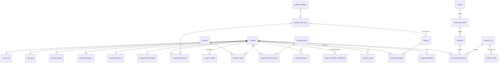

# Datenmodell – Yellotools Market Intelligence

Stand: 2026-10-18 · Phase 1 · relational, Zielsystem PostgreSQL ≥ 16 (SQLite für Einzelplatz,
siehe `ARCHITECTURE.md` ADR-04)

## 1. Grundregeln

1. **Nichts wird überschrieben.** Beobachtungen (`*_observation`, `business_signal`) sind
   append-only. Korrekturen sind neue Zeilen mit `supersedes_id`.
2. **Jede Kennzahl hat**: Bezugszeitraum (`period_start`, `period_end`, `period_type`),
   Erfassungszeitpunkt (`captured_at`), Quelle (`source_id` → `source_document_id`),
   Herkunftsklasse (`provenance_class`), Prüfstatus (`verification_status`), Vertrauensniveau
   (`confidence`), Einheit/Währung, Methodik.
3. **Fehlend ist ein eigener Zustand.** Gezielt gesucht und nicht gefunden → `data_gap`.
   Nie gesucht → kein Eintrag. Beides ist in der Oberfläche unterscheidbar.
4. **Zeitstempel in UTC** (`timestamptz`). Bezugszeiträume als Datum.
5. **Beträge** als `NUMERIC(24,6)` in Originalwährung; Umrechnungen sind abgeleitete Werte mit
   Kursquelle (EZB-Referenzkurs) und Kursdatum.
6. **IDs**: UUIDv7 (zeitlich sortierbar), als `uuid` bzw. Text in SQLite.
7. **Soft-Delete** nur für Stammdaten (`archived_at`); Beobachtungen werden nie gelöscht, nur
   als `rejected` markiert (Ausnahme: gesetzliche Löschpflichten, siehe
   `SECURITY_AND_PRIVACY.md`).

## 2. Aufzählungen

| Typ | Werte | Bedeutung |
|---|---|---|
| `provenance_class` | `official` | amtlich/registerlich veröffentlicht (Register, Bundesanzeiger, SEC-Filing, Statistikamt) |
| | `company_reported` | vom Unternehmen selbst (Webseite, Pressemitteilung, freiwilliger Bericht) |
| | `third_party` | unabhängiger Dritter (Datenanbieter, Presse, Verband) |
| | `derived` | rechnerisch aus anderen Beobachtungen abgeleitet (Formel gespeichert) |
| | `estimate` | Schätzung mit dokumentierter Methode (nie ohne Kennzeichnung angezeigt) |
| `verification_status` | `confirmed` | durch ≥1 Quelle der Klasse `official` belegt oder durch Nutzer bestätigt |
| | `reported` | eine nicht-amtliche Quelle, kein Widerspruch |
| | `estimated` | Herkunftsklasse `estimate` |
| | `conflicting` | widerspricht anderer Beobachtung desselben Schlüssels (Toleranz überschritten) |
| | `unverified` | maschinell extrahiert, Prüfung ausstehend (z. B. LLM-Extraktion mit niedriger Sicherheit) |
| | `rejected` | vom Nutzer oder durch Regel verworfen (bleibt zur Nachvollziehbarkeit erhalten) |
| | `superseded` | durch neuere Angabe derselben Quelle ersetzt (z. B. korrigierter Abschluss) |
| `confidence` | `high`, `medium`, `low` | Einschätzung der Extraktions-/Quellenqualität |
| `period_type` | `fiscal_year`, `calendar_year`, `half_year`, `quarter`, `point_in_time`, `range` | |
| `consolidation_scope` | `group`, `single_entity`, `segment`, `unknown` | Konzern vs. Einzelgesellschaft |
| `value_kind` | `point`, `range`, `lower_bound`, `upper_bound`, `size_class` | z. B. „50–249 Mitarbeiter“ als `range` |

Fehlende Daten sind **keine** `provenance_class`, sondern ein `data_gap`-Eintrag (§3.16).

## 3. Entitäten

Pflichtfelder fett. Fremdschlüssel mit →.

### 3.1 `company`

| Feld | Typ | Hinweis |
|---|---|---|
| **id** | uuid | |
| **display_name** | text | bevorzugter Anzeigename |
| legal_name | text | rechtlicher Name laut Register (sonst leer, nicht geraten) |
| legal_form | text | normalisiert (GmbH, AG, SE, Ltd, Inc, …) |
| entity_kind | enum | `legal_entity`, `group` (virtuelle Konzernklammer), `brand_holder_unknown` |
| **country_code** | char(2) | Sitzland ISO 3166-1 |
| registered_city | text | |
| website_domain | text | normalisiert (ohne `www.`) |
| status | enum | `active`, `dissolved`, `insolvent`, `merged`, `unknown` |
| founded_year | int | nur mit Quelle (sonst leer) |
| merged_into_id | → company | gesetzt nach Zusammenführung (reversibel über `entity_merge`) |
| created_at, updated_at, archived_at | timestamptz | |

Profilangaben wie Umsatz, Mitarbeiter, Branche stehen **nicht** in `company`, sondern als
Beobachtungen bzw. Zuordnungen mit Quelle.

### 3.2 `company_identifier`

| Feld | Typ | Hinweis |
|---|---|---|
| **id**, **company_id** → company | | |
| **scheme** | enum | `lei`, `de_register` (Gericht+Art+Nummer, z. B. `Siegburg HRB 1234`), `vat`, `sec_cik`, `uk_crn`, `nl_kvk`, `ie_cro`, `wikidata`, `duns` (nur mit Lizenz), `opencorporates`, `northdata`, `domain` |
| **value** | text | normalisiert |
| **source_document_id** → source_document | | Beleg |
| valid_from, valid_to | date | |
| UNIQUE (`scheme`, `value`) WHERE `valid_to IS NULL` | | verhindert Doppelzuordnung starker IDs |

### 3.3 `company_alias`

| Feld | Typ | Hinweis |
|---|---|---|
| **id**, **company_id** | | |
| **alias** | text | Originalschreibweise |
| **normalized** | text | Kleinbuchstaben, Umlaute transliteriert, Rechtsform/Satzzeichen entfernt |
| **alias_type** | enum | `former_name`, `trade_name`, `brand`, `abbreviation`, `spelling_variant`, `translation` |
| source_document_id | → | |
| valid_from, valid_to | date | |

Index: Trigramm-Index (`pg_trgm`) auf `normalized` für unscharfe Suche.

### 3.4 `parent_company_relationship`

| Feld | Typ | Hinweis |
|---|---|---|
| **id** | | |
| **parent_company_id**, **child_company_id** → company | | |
| **relationship_type** | enum | `direct_parent`, `ultimate_parent`, `branch` (Zweigniederlassung, rechtlich unselbstständig), `brand_owner`, `joint_venture`, `minority_stake` |
| ownership_pct | numeric(7,4) | nur mit Beleg; GLEIF Level 2 liefert keine Prozente |
| basis | enum | `accounting_consolidation`, `legal_ownership`, `declared_by_company`, `unknown` |
| **source_document_id**, provenance_class, verification_status | | |
| valid_from, valid_to | date | |
| **captured_at** | timestamptz | |

Append-only wie Beobachtungen. Zyklen werden beim Einfügen geprüft und abgelehnt.

### 3.5 `industry`

Hierarchische Klassifikation.

| Feld | Typ | Hinweis |
|---|---|---|
| **id**, **scheme** | | `nace_rev2`, `nace_rev2_1`, `wz2008`, `wz2025`, `naics2022`, `sic_uk2007`, `custom` |
| **code**, **label_de**, label_en | | |
| parent_id → industry | | |
| UNIQUE (`scheme`, `code`) | | |

`industry_mapping` (`from_id`, `to_id`, `mapping_type` = exact/partial) für Korrespondenztabellen
(NACE Rev. 2 ↔ Rev. 2.1, WZ ↔ NACE).

`company_industry` (`company_id`, `industry_id`, `is_primary`, `source_document_id`,
`provenance_class`, `captured_at`) – append-only.

### 3.6 `product_category`

Yellotools-Produktgruppen, Quelle ist der Artikelstamm (Import) bzw. die Pflege durch den
Vertrieb.

| Feld | Typ | Hinweis |
|---|---|---|
| **id**, **name_de**, name_en | | z. B. „Rakel“, „Schneidwerkzeuge“, „Entfernungswerkzeuge“ |
| parent_id → product_category | | |
| article_numbers | text[] | Zuordnung zu Artikelnummern (z. B. `YT23WSLOAN01`) |
| description | text | |
| status | enum | `draft`, `approved` (nur `approved` fließt ins Scoring) |

### 3.7 `product_use_case`

| Feld | Typ | Hinweis |
|---|---|---|
| **id**, **name_de** | | z. B. „Folienapplikation auf Glasflächen“ |
| description | text | |
| **evidence_status** | enum | `hypothesis` (vom Planungsteam vermutet), `validated_by_sales`, `validated_by_customer_data` |
| search_terms | text[] | Begriffe für Discovery (de/en/…) |
| negative_terms | text[] | Ausschlussbegriffe |

Verknüpfungen: `use_case_product_category` (n:m) und `use_case_industry` (n:m mit `relevance`
1–3 und Begründung).

### 3.8 `company_location`

| Feld | Typ | Hinweis |
|---|---|---|
| **id**, **company_id** | | |
| **location_type** | enum | `registered_office`, `headquarters`, `production`, `warehouse`, `sales_office`, `branch`, `service`, `unknown` |
| **country_code**, city, postal_code, street | | nur Firmenadressen, keine Privatadressen |
| lat, lon | numeric | optional, nur aus Quelle oder Geokodierung mit Quelle |
| **source_document_id**, provenance_class, verification_status | | |
| first_seen_at, last_seen_at | timestamptz | |
| closed_reported_at | date | Schließung laut Quelle |

Append-only im Sinne von: Statusänderungen sind neue Zeilen; `last_seen_at` wird bei erneuter
Bestätigung aktualisiert (einzige erlaubte Aktualisierung, protokolliert).

### 3.9 `country_market`

Präsenz eines Unternehmens in einem Ländermarkt.

| Feld | Typ | Hinweis |
|---|---|---|
| **id**, **company_id**, **country_code** | | |
| **presence_type** | enum | `subsidiary`, `branch`, `distributor`, `sales_reported`, `customers_reported`, `tender_won`, `website_language_only` (schwaches Indiz) |
| revenue_share_pct | numeric | nur mit Beleg |
| **source_document_id**, provenance_class, verification_status, confidence | | |
| period_start, period_end | date | |
| **captured_at** | timestamptz | |

### 3.10 Gemeinsame Spalten aller Beobachtungen

Gilt für §3.11–§3.14.

| Feld | Typ | Hinweis |
|---|---|---|
| **id**, **company_id** → company | | |
| **metric** | enum/text | siehe je Tabelle |
| **value_kind** | enum | point/range/… |
| value | numeric(24,6) | bei `point` |
| value_low, value_high | numeric(24,6) | bei Bereichen/Größenklassen |
| **unit** | text | `EUR`, `USD`, `persons`, `FTE`, `count`, `pct` |
| currency | char(3) | ISO 4217, bei Geldbeträgen Pflicht |
| scale_note | text | Originalangabe „in TEUR“, „Mio.“ – Normalisierung dokumentiert |
| **period_type**, **period_start**, **period_end** | | |
| fiscal_year_label | text | z. B. „GJ 2024/25“ |
| **consolidation_scope** | enum | |
| **provenance_class**, **verification_status**, **confidence** | | |
| **source_document_id** → source_document | | |
| **evidence_id** → evidence | | Zitat/Fundstelle |
| methodology | text | Pflicht bei `derived` und `estimate` |
| derived_from | uuid[] | Pflicht bei `derived` (Eingangsbeobachtungen) |
| **captured_at** | timestamptz | Erfassungszeitpunkt im System |
| last_seen_at | timestamptz | letzte erneute Bestätigung durch dieselbe Quelle |
| **research_run_id** → research_run | | |
| supersedes_id → gleiche Tabelle | | |
| limitations | text | Einschränkungen („nur Inland“, „inkl. Leiharbeitnehmer“) |
| content_hash | text | Duplikaterkennung (Firma, Metrik, Zeitraum, Scope, Wert, Quelle) |

Index für Abfragen und Konfliktprüfung: (`company_id`, `metric`, `period_end`,
`consolidation_scope`).

### 3.11 `financial_observation`

`metric` ∈ `revenue`, `revenue_segment` (+ `segment_label`), `ebit`, `ebitda`, `net_income`,
`total_assets`, `equity`, `capex`, `r_and_d_expense`, `export_share_pct`, `order_intake`,
`size_class_hgb` (klein/mittel/groß nach § 267 HGB als `size_class`).

### 3.12 `employee_observation`

`metric` ∈ `headcount_total`, `headcount_avg_year`, `fte`, `headcount_country`
(+ `country_code`), `headcount_location` (+ `location_id`), `employee_size_class`.
`definition_note` Pflicht, wenn die Quelle die Zählweise nennt (z. B. „ohne Auszubildende“).

### 3.13 `hiring_observation`

Aggregierte Stellenmarkt-Beobachtung, **keine personenbezogenen Daten** (keine Namen von
Ansprechpartnern, keine Recruiter).

| Zusatzfeld | Hinweis |
|---|---|
| **observation_date** | Stichtag der Zählung |
| open_positions_count | Anzahl offener Stellen zum Stichtag |
| job_family | normalisiert: `production`, `installation_montage`, `logistics`, `sales`, `engineering`, `other` |
| country_code, city | Einsatzort |
| sample_titles | text[] – höchstens 10 Stellentitel als Beleg |
| relevant_use_case_ids | uuid[] – Stellen, die auf Anwendungsfälle deuten (z. B. „Folierer“, „Monteur Sonnenschutzfolie“) |

### 3.14 `layoff_observation`

| Zusatzfeld | Hinweis |
|---|---|
| **announced_date** | |
| affected_count, affected_pct | nur mit Beleg |
| location_id / country_code | |
| event_type | `layoff`, `site_closure`, `short_time_work`, `insolvency_filing`, `restructuring` |

### 3.15 `business_signal`

Qualitative Ereignisse, die auf Bedarf oder Veränderung hindeuten.

| Feld | Typ | Hinweis |
|---|---|---|
| **id**, **company_id**, **signal_type** | | `new_location`, `expansion`, `investment`, `acquisition`, `divestment`, `new_product_line`, `tender_published`, `tender_awarded`, `fleet_expansion`, `rebranding`, `partnership`, `funding`, `management_change` (nur Funktion, kein Name ohne Notwendigkeit), `insolvency`, `other` |
| **event_date** | date | wann das Ereignis stattfand/angekündigt wurde |
| **summary** | text | sachliche Kurzbeschreibung, max. 500 Zeichen, eigene Formulierung |
| amount, currency | | z. B. Investitionsvolumen, nur mit Beleg |
| country_code, location_id | | |
| related_use_case_ids | uuid[] | |
| **source_document_id**, **evidence_id**, provenance_class, verification_status, confidence | | |
| **captured_at**, research_run_id | | |
| dedup_key | text | gleiche Meldung aus mehreren Quellen → eine Signal-Gruppe |

### 3.16 `data_gap`

| Feld | Hinweis |
|---|---|
| **id**, **company_id**, **metric**, period_start/period_end | |
| **searched_sources** | text[] – welche Quellen geprüft wurden |
| **reason** | `not_published`, `source_unavailable`, `below_disclosure_threshold`, `access_restricted` (Paywall/Login – nicht umgangen), `legal_blocked`, `not_found` |
| **research_run_id**, **checked_at** | |

### 3.17 `source` (Quellenregister)

| Feld | Hinweis |
|---|---|
| **id**, **key** (z. B. `gleif`, `sec_edgar`, `website`) | |
| **name**, publisher, base_url | |
| **source_type** | `register`, `official_statistics`, `regulator_filing`, `company_website`, `press`, `job_board`, `tender_portal`, `data_provider`, `search_engine`, `association`, `open_knowledge_base` |
| **default_provenance_class** | |
| **license** | z. B. `CC0-1.0`, `CC-BY-4.0`, `DL-DE-BY-2.0`, `proprietary-contract`, `unclear` |
| **terms_url**, terms_checked_at, terms_checked_by | |
| **legal_status** | `approved`, `approved_with_conditions`, `pending_review`, `blocked` – nur `approved*` darf abgerufen werden |
| conditions | Freitext (z. B. „max. 60 Abrufe/h, nur manuell ausgelöst“) |
| rate_limit_per_minute, daily_quota, cost_per_call, currency | |
| retention_policy | `full_content`, `excerpt_only`, `metadata_only` |
| is_active | |

### 3.18 `source_document`

Ein konkret abgerufenes Dokument (Seite, API-Antwort, PDF).

| Feld | Hinweis |
|---|---|
| **id**, **source_id** | |
| **url** (Original-URL), final_url (nach Weiterleitung) | |
| title, publisher, author_org | |
| published_at | Veröffentlichungsdatum laut Dokument (falls erkennbar, sonst leer) |
| **retrieved_at** | Abrufzeitpunkt |
| **http_status**, content_type, language | |
| **sha256** | Inhaltshash |
| storage_ref | Pfad/Objekt-Schlüssel der gespeicherten Kopie (je `retention_policy`) |
| text_ref | extrahierter Text (für Zitatprüfung) |
| covered_period_start, covered_period_end | betroffener Zeitraum (z. B. GJ des Berichts) |
| robots_allowed, tdm_reservation_detected | Ergebnis der Prüfungen |
| research_run_id | |
| UNIQUE (`source_id`, `url`, `sha256`) | gleiche Version nur einmal |

### 3.19 `evidence`

| Feld | Hinweis |
|---|---|
| **id**, **source_document_id** | |
| **locator** | Seite, Tabellenzelle, CSS-Pfad, JSON-Pfad, XBRL-Element |
| quote | wörtliches Zitat, max. 1 000 Zeichen |
| **extraction_method** | `api_field`, `xbrl`, `table_rule`, `regex_rule`, `llm`, `manual` |
| extractor_version | z. B. `rules-1.3.0`, `llm:claude-opus-5-5:prompt-v4` |
| **quote_verified** | bool – Zitat im gespeicherten Text gefunden und Zahl im Zitat enthalten |
| calculation | Formel bei abgeleiteten Werten |
| notes | |

### 3.20 `research_run`

| Feld | Hinweis |
|---|---|
| **id**, **run_type** | `market_leaders`, `customer_discovery`, `company_profile`, `watchlist_refresh`, `signal_scan` |
| **parameters** | JSON (Branchen, Länder, Produktkategorien, Größengrenzen) |
| **status** | `draft`, `queued`, `running`, `pausing`, `paused`, `cancelling`, `cancelled`, `completed`, `completed_with_gaps`, `failed` |
| **budget_limit**, budget_currency, **cost_spent** | |
| max_api_calls, max_llm_tokens | |
| created_by → app_user, created_at, started_at, finished_at | |
| progress | JSON (Aufgaben je Status) |
| summary | Ergebnis, Lücken, Fehler |
| parent_run_id | Wiederholung/Fortsetzung |

`research_task`: **id**, **run_id**, **task_type**, **params** (JSON), **idempotency_key**
(UNIQUE je Run), **status** (`pending`, `blocked`, `leased`, `succeeded`, `failed_retryable`,
`failed_permanent`, `skipped`, `cancelled`), attempt, max_attempts, leased_by, leased_until,
next_attempt_at, depends_on (uuid[]), error_code, error_detail, cost, started_at, finished_at.

`cost_ledger`: **id**, **run_id**, task_id, **source_id**, **kind** (`api_call`, `llm_tokens`,
`search_query`, `data_provider`), quantity, **amount**, currency, at.

### 3.21 `company_product_fit`

| Feld | Hinweis |
|---|---|
| **id**, **company_id**, **use_case_id**, product_category_id | |
| **fit_level** | `strong`, `plausible`, `weak`, `excluded` |
| **rationale** | Begründungstext |
| **supporting_evidence_ids** | uuid[] → evidence / business_signal / hiring_observation |
| **assessed_by** | `rule:<regel-id>@<version>` oder Benutzer |
| assessed_at, research_run_id | |
| supersedes_id | |

Ohne mindestens einen Beleg kann kein `strong`/`plausible` gesetzt werden (Prüfung im Dienst).

### 3.22 `opportunity_assessment`

| Feld | Hinweis |
|---|---|
| **id**, **company_id**, market_country_code, product_category_id | |
| **scoring_model_id** → scoring_model (Version) | |
| **total_score** (0–100) | |
| **components** | JSON: je Indikator Rohwert, normierter Wert, Gewicht, Beitrag, Verweise auf Beobachtungen/Signale |
| **data_completeness_pct** | Anteil der Indikatoren mit Daten |
| **uncertainty_note** | Lücken und Widersprüche, die den Score beeinflussen |
| **priority** | `A`, `B`, `C`, `insufficient_data` |
| assessed_at, research_run_id | |

`scoring_model`: **id**, **version**, **definition** (JSON: Indikatoren, Normierung, Gewichte,
Schwellen), created_by, created_at, approved_at, is_active. Versionen sind unveränderlich.

### 3.23 `user_note`

**id**, **target_type** (`company`, `observation`, `signal`, `opportunity`, `research_run`),
**target_id**, **author_id** → app_user, **visibility** (`private`, `team`), **body**,
created_at, edited_at (Bearbeitungen werden in `audit_log` versioniert).

### 3.24 `watchlist`

**id**, **name**, **owner_id**, **visibility**, description, **refresh_schedule** (cron-ähnlich,
z. B. monatlich), **alert_rules** (JSON: Kennzahl ändert sich um > x %, neues Signal vom Typ y),
created_at, archived_at.

`watchlist_entry`: **watchlist_id**, **company_id**, added_by, added_at, reason.

### 3.25 Unterstützende Tabellen

| Tabelle | Zweck |
|---|---|
| `change_event` | erkannte Veränderung: company_id, metric/signal, alter gültiger Wert, neuer gültiger Wert, Beobachtungs-IDs, Δ absolut/%, erkannt am, Run |
| `review_item` | Prüfliste: Typ (`conflict`, `merge_candidate`, `unverified_extraction`, `legal_question`), Bezug, Status, Entscheidung, Begründung, Entscheider |
| `entity_match_candidate` | Paar (company_a, company_b), Score, Merkmale (JSON), Status |
| `entity_merge` | Zusammenführung: surviving_id, merged_id, Grund, Merkmale, ausgeführt von/am, rückgängig gemacht am |
| `fx_rate` | EZB-Referenzkurse (Datum, Währung, Kurs, source_document_id) |
| `http_cache_entry` | Cache-Schlüssel, ETag, Last-Modified, gültig bis, source_document_id |
| `rate_limit_state` | Token-Bucket je Quelle/Host |
| `schedule` | Zeitpläne für Watchlists und Quellen-Gesundheitsprüfungen |
| `app_user`, `role_assignment` | Benutzer und Rollen (Teambetrieb) |
| `audit_log` | jede schreibende Benutzeraktion, Merge, Freigabe, Export |
| `export_job` | Exportaufträge mit Parametern, Datei-Hash, Ersteller |

## 4. Beziehungen (Übersicht)

## 5. Regeln für den Prüfstatus

| Situation | `verification_status` |
|---|---|
| Wert aus `official`-Quelle, maschinenlesbar (API/XBRL) | `confirmed` |
| Wert aus `official`-Dokument, regelbasiert extrahiert, Zitat verifiziert | `confirmed` |
| Wert aus `company_reported` oder `third_party`, Zitat verifiziert, kein Widerspruch | `reported` |
| LLM-Extraktion, Zitat verifiziert, `confidence` ≠ high | `unverified` (Prüfliste) |
| Zitat nicht verifizierbar | **wird nicht gespeichert** (nur Protokoll + Zähler) |
| Abweichung zu anderer Beobachtung desselben Schlüssels > Toleranz | beide `conflicting` |
| Nutzer bestätigt | `confirmed` + `audit_log` |

Toleranzen (Startwerte, konfigurierbar): Umsatz ±2 % (Rundung „Mio.“), Mitarbeiter ±5 % oder
±10 Personen, Größenklassen müssen sich überlappen.

## 6. Ableitung des gültigen Werts

Für jeden Schlüssel (Firma, Kennzahl, Zeitraum, Konsolidierungskreis), unter Ausschluss von
`rejected` und `superseded`:

1. Vom Nutzer bestätigter Wert gewinnt.
2. Sonst `official` vor `company_reported` vor `third_party` vor `derived` vor `estimate`.
3. Innerhalb derselben Klasse: neuestes `published_at`, dann neuestes `captured_at`.
4. Ist der Schlüssel `conflicting` und nicht durch 1. entschieden → gültiger Wert wird **mit
   Konfliktkennzeichen** angezeigt, alle Alternativen sichtbar.

Umgesetzt als SQL-Sicht `v_current_metric` plus materialisierte Tabelle für schnelle Listen
(neu berechnet bei jeder Aufnahme).

## 7. Entity Resolution

**Normalisierung** von Namen: Unicode NFKC, Kleinbuchstaben, ä→ae usw., Entfernen von
Rechtsformen (Liste je Land: GmbH, GmbH & Co. KG, AG, SE, KG, OHG, UG (haftungsbeschränkt),
e.K., Ltd, Limited, PLC, Inc, LLC, Corp, S.A., S.r.l., B.V., N.V., Sp. z o.o., …), Satzzeichen,
Füllwörter („Gruppe“, „Holding“ nur markiert, nicht entfernt).

**Verfahren:**

1. **Exakter Identifikator** (Schema + Wert) → gleiche Firma, automatische Zuordnung.
2. **Blocking**: Kandidaten mit gleichem Land und (Trigramm-Ähnlichkeit Name ≥ 0,4 **oder**
   gleiche Domain **oder** gleiche PLZ).
3. **Merkmalsvektor**: Namensähnlichkeit (Jaro-Winkler, Token-Set), Rechtsformgleichheit,
   Ort/PLZ, Domain, Telefonvorwahl, Branche, gemeinsame Mutter.
4. **Entscheidung**: Score ≥ hohe Schwelle → `merge_candidate` mit Vorschlag; mittlere
   Schwelle → Kandidat ohne Vorschlag; darunter → neue Firma. **Kein automatisches Merge ohne
   Identifikator.**
5. **Harte Ausschlüsse**: unterschiedliche starke IDs desselben Schemas, unterschiedliche
   Rechtsform bei gleichem Namen (z. B. „X GmbH“ vs. „X AG“ können Mutter/Tochter sein → als
   Beziehungskandidat, nicht als Merge).
6. **Marken**: Markenname ≠ Firma. Marken werden als `company_alias(alias_type=brand)` beim
   Markeninhaber geführt, sobald der Inhaber belegt ist.
7. **Tochtergesellschaften** bleiben eigene `company`-Zeilen, verbunden über
   `parent_company_relationship`; Konzernsichten aggregieren über die Beziehung, nicht über Merge.

Qualitätsziel (Abnahme in M5): auf einem handgeprüften Testsatz ≥ 300 Paaren keine falschen
automatischen Merges; Kandidatenliste enthält ≥ 90 % der echten Duplikate.

## 8. Migrationen und Datenpflege

- Alembic-Migrationen nur vorwärts; vor jeder Migration Sicherung (`pg_dump` bzw.
  SQLite-Backup-API).
- Referenzdaten (NACE, WZ, ISO-Länder, ISO-Währungen) als versionierte Seed-Dateien mit Quelle.
- Archivierung alter Rohdokumente gemäß `retention_policy`; Beobachtungen und Evidence-Zitate
  bleiben erhalten.
